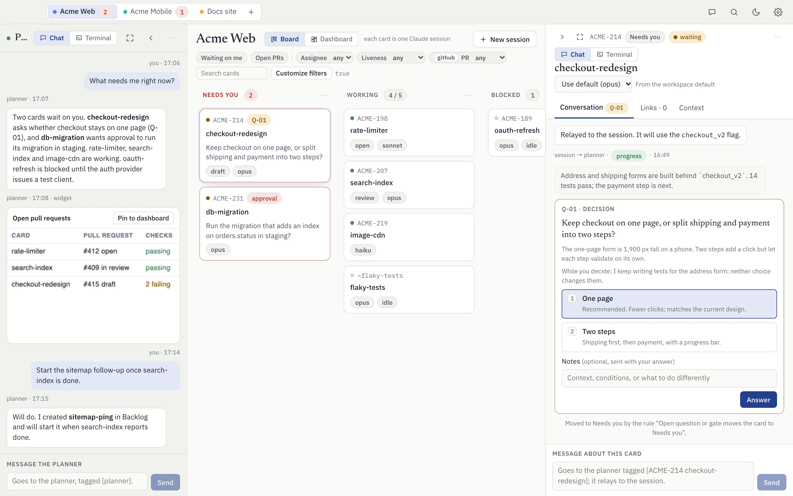
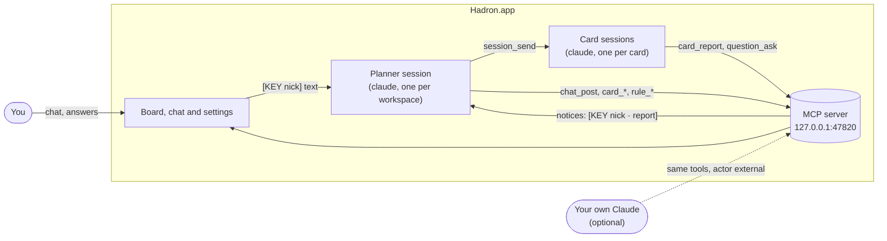
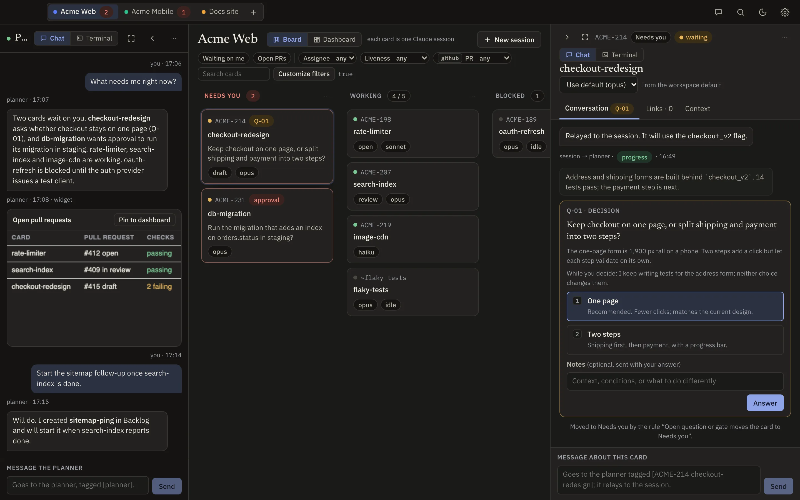
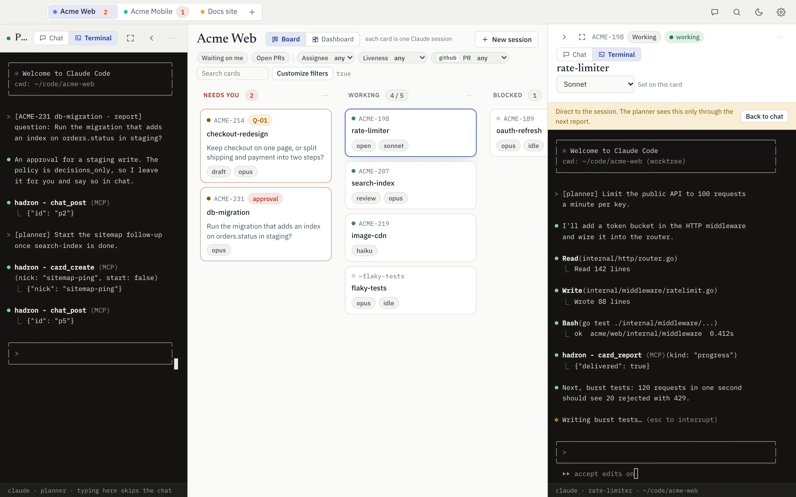
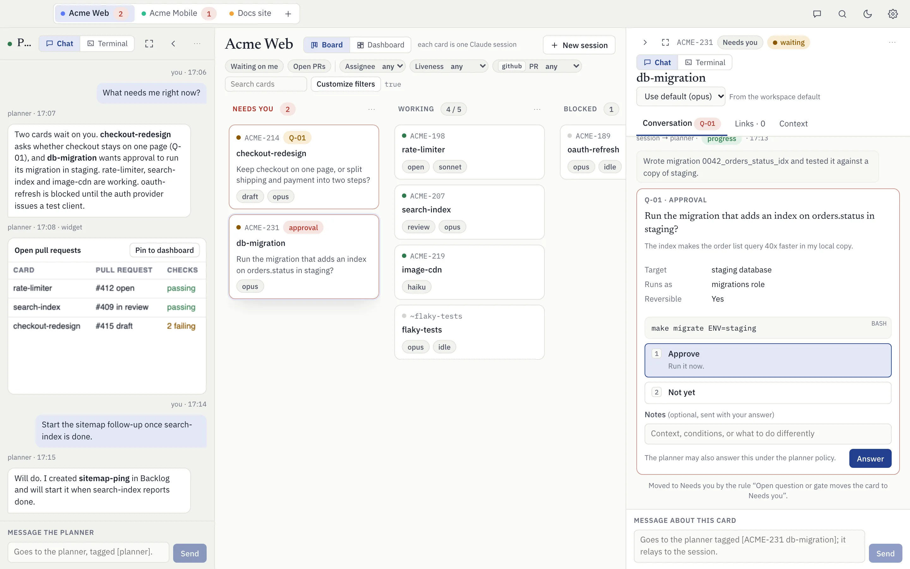
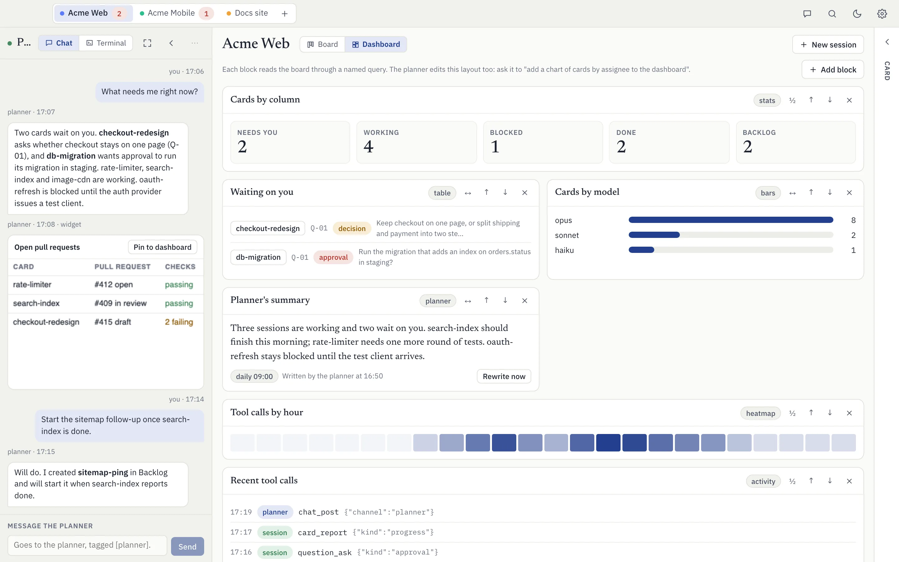
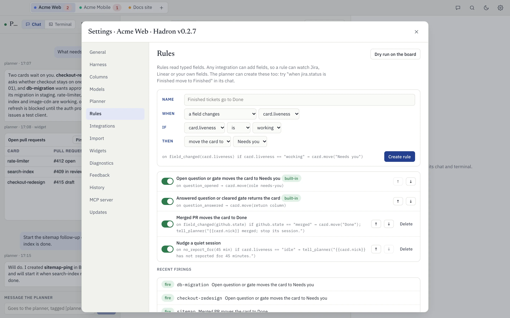
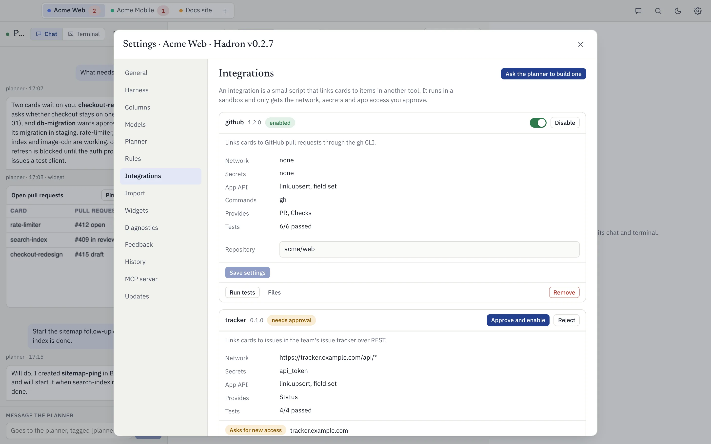
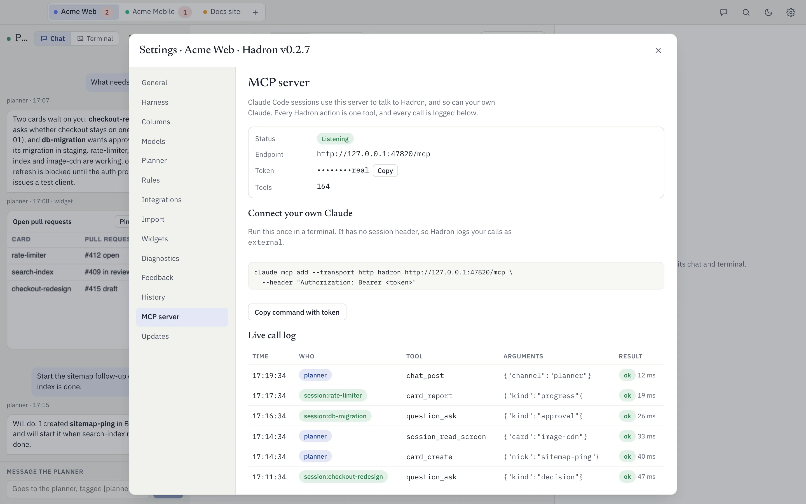

<div align="center">


# Hadron

**A native macOS board where every card is a Claude Code session, and one planner runs them all.**

[](https://github.com/GabiHert/hadron/releases/latest)
[](#install)
[](#build-from-source)



</div>

Hadron is a desktop app for running many Claude Code sessions at once without losing track of them.
You put work on a kanban board, each card starts its own `claude` session, and a planner session
keeps the board current, relays your messages and brings you only the decisions that need you.

- **The board.** Each workspace has a board with columns you name. A card is one Claude Code session
  that Hadron starts, owns and resumes.
- **The planner.** One planner session per workspace proxies every chat: you talk to the planner, and
  the planner talks to the sessions.
- **The window.** The board sits in the middle, the planner panel on the left and the card panel on
  the right. Both panels switch between Chat and a real terminal, and both collapse.
- **Everything is an MCP tool.** Every action in the UI is also a tool on a local MCP server, so any
  Claude, including the planner, can configure and drive Hadron the way you do.
- **Local first.** One user, one Mac. Your data lives in `~/.hadron`.

## Contents

- [How it works](#how-it-works)
- [Features](#features)
- [Install](#install)
- [Connect your own Claude over MCP](#connect-your-own-claude-over-mcp)
- [Build from source](#build-from-source)
- [Release](#release)
- [Repository layout](#repository-layout)
- [Contributing](#contributing)
- [License and credits](#license-and-credits)

## How it works



1. You type in a card's chat. Hadron types it into the planner's terminal as `[ACME-214 checkout-redesign] <text>`.
2. The planner decides what to do and relays it to the card's session.
3. The session reports back with `card_report` (progress, blocked, done) or asks with `question_ask`.
   Hadron types a one-line notice into the planner, such as `[ACME-214 checkout-redesign · report] progress: ...`.
   Only Hadron can write the middle dot, so a line without it is always you.
4. A question moves the card to **Needs you** until someone answers it. The planner policy decides
   whether the planner may answer it or must bring it to you.

Every session starts with Hadron's MCP server already configured, a session id that Hadron stores,
and a layered system prompt (the built-in harness, then your workspace, launch-profile and card
prompts). A session can call `hadron_guide` to read how any part of Hadron works.

## Features

### The board



- **Columns you control.** Rename, reorder, fold, color and delete columns, and set a WIP limit.
  Each column has a role (`needs-you`, `active`, `blocked`, `done`, `backlog`); rules use the role,
  never the name, so you can rename freely.
- **Cards that show state at a glance.** A dot shows liveness (working, idle, waiting, ended), a
  pill shows an open question or approval, and chips show linked fields and the card's model.
- **Filters and views.** Filter by any field, search by nickname, write a CEL expression, and save
  the result as a view.
- **Workspaces.** Switch with the tabs in the header. A red count shows how many cards need you in
  each one. `Cmd K` opens the palette, and `Cmd N` starts a new session.
- **Light and dark themes**, from the moon button or your system setting.

### Card chat and terminal



The card panel has a **Chat** view and a **Terminal** view.

- **Chat** shows what you wrote, what the planner relayed, the session's reports and its questions.
  What you write goes to the planner, tagged with the card.
- **Terminal** is the session's real PTY (xterm.js over `creack/pty`). Typing there goes straight to
  the session and skips the planner.
- **Per-card model.** Pick Opus, Sonnet, Haiku or any model id per card. A card inherits from its
  launch profile, then the workspace default, then Claude's own default. Changing the model of a
  running session types `/model` into it.
- **Links and Context tabs** show linked items from integrations and the card's own prompt layer.
- **Worktrees.** A launch profile with worktrees on starts each card in
  `<root>/.hadron-worktrees/<nick>` on branch `hadron/<nick>` when the workspace root is a git
  repository. Deleting a card leaves its worktree on disk.
- **Sessions survive restarts.** After Hadron restarts or updates, running sessions resume their
  conversations: the planner first, then the cards. A session you stopped stays stopped.

### The planner

The planner is a Claude Code session with Hadron's tools. You talk to it in the left panel, and it
creates cards, starts and stops sessions, relays your messages, reads session screens, edits rules
and the dashboard, and posts widgets, such as the pull-request table in the screenshot above.

Settings, Planner sets its launch profile, model, policy and whether it starts when Hadron opens.
You can also adopt a Claude Code conversation you started elsewhere as the planner, or bring one in
as a card.

### Questions, approvals and Needs you



- A session asks with `question_ask`: a **decision**, an **unblock** or an **approval**, with
  options, context and what it does meanwhile.
- An approval states its target, who it runs as, whether it can be undone and the exact command.
- You answer with one or more options plus optional notes. The answer goes back to the planner, and
  the built-in rule returns the card to the column it came from.
- The **planner policy** decides what the planner may answer on its own: `allow_all`,
  `decisions_only`, `ask_for_prd` or `user_only`. Set it globally or per workspace. A session can
  never answer its own question.
- **Gates** (merge, promote, deploy-confirm, close) hold a card in Needs you until you clear them.

### Dashboard



The Dashboard switch above the board shows blocks that read the board through named queries:
tiles, bars, tables, a heatmap, text, recent tool calls, a summary the planner writes on a schedule
or on demand, and HTML widgets pinned from chat. Add, resize and reorder blocks yourself, or ask
the planner to "add a chart of cards by assignee to the dashboard".

Widgets render in a sandboxed frame with no network, no cookies, no access to Hadron and your theme
as CSS variables. Scripts inside widgets stay off unless you turn them on in Settings, Widgets.

### Settings: rules, integrations and more

<table>
<tr>
<td width="50%"></td>
<td width="50%"></td>
</tr>
</table>

- **Rules** run when something happens: a field changes, a card enters a column, a card is
  created, a report or question arrives, a question is answered, a card is idle or quiet for a
  number of minutes, or a cron schedule fires. A CEL condition narrows them, and actions move the
  card, set a field, notify you, tell the planner or run a script action. Use **Dry run on the
  board** to see what would change before you save.
- **Integrations** link cards to items in other tools and add their fields, such as `github.state`,
  to filters, rules and the dashboard. An integration is a manifest plus a JavaScript file that runs
  in a [goja](https://github.com/dop251/goja) sandbox:
  - It can only use the network patterns, secrets, binaries and Hadron API methods its manifest
    lists. Anything else throws a `PermissionError` that names the missing permission.
  - Secrets reach the script as opaque handles, are stored in the macOS keychain, and are removed
    from every output, log and error.
  - Each call gets 10 seconds of script time and 64 MB of memory, with no `require` and no timers.
  - Recorded tests must pass before you approve it. Starters: `github` (the `gh` CLI), `jira`
    (REST), `linear` (the Linear MCP server) and `empty`.
- **Fields** are typed (text, number, enum, user, date, bool) and come from the card, your custom
  fields or an integration.
- **Harness** shows the layered prompts: the built-in core (read-only), the workspace layer and
  the composed result. Launch profiles and cards add their own layers.
- **Models**, **Columns**, **Planner**, **Import**, **Widgets** and **MCP server** each have a tab.

### Operations

- **History.** Every config change records who made it and what changed, and you can revert it.
- **Feedback.** The speech-bubble button sends a note about Hadron itself to Settings, Feedback,
  where you can track it and open it as a prefilled GitHub issue. Tell the planner "feedback: ..."
  and it files the note for you.
- **Diagnostics.** Turn on debug logging to write JSON lines under `~/.hadron/logs`, kept for seven
  days. Secrets, tokens and message text are never logged. The tab tails the log and copies a
  diagnostics block for a bug report.
- **Self-update.** Hadron checks GitHub Releases a minute after launch and every six hours. Settings,
  Updates downloads the new version, checks its SHA-256 and code signature, swaps the app and rolls
  back if the new version does not start. **What's new** shows the changelog after an update.

## Install

Requirements: macOS 14 or later on Apple silicon, and the
[Claude Code CLI](https://docs.anthropic.com/en/docs/claude-code) installed and signed in. Hadron
starts `claude` for you.

1. Download `Hadron-<version>-darwin-arm64.zip` from the
   [latest release](https://github.com/GabiHert/hadron/releases/latest).
2. Optional: check the download against `SHA256SUMS` from the same release:

   ```sh
   shasum -a 256 -c SHA256SUMS
   ```

3. Unzip it and move `Hadron.app` to `/Applications` before you open it. An ad hoc signed app
   opened from the folder it was downloaded to runs from a temporary read-only copy (App
   Translocation), and self-update cannot replace it there.
4. Open it. The app is signed ad hoc, so macOS may say it cannot verify the developer. Right-click
   `Hadron.app`, choose **Open**, then **Open** again. You only do this once.

### First run

1. **Create a workspace.** Pick a name and the folder your sessions work in. It starts with the
   columns Needs you, Working, Blocked, Done and Backlog, two built-in rules and a default dashboard.
2. **Check the planner.** It starts with the workspace. Switch the planner panel to Terminal to
   watch it.
3. **Add a session.** Press `Cmd N`, give the card a nickname (and a key such as `ACME-508` if you
   track work elsewhere), choose a launch profile and start it.
4. **Talk.** Type in the card's chat or the planner's chat. Answer questions where they appear.

Closing the window (`Cmd W`) hides Hadron and keeps your sessions running. `Cmd Q` quits.

## Connect your own Claude over MCP



Hadron serves an MCP server (Streamable HTTP) on `127.0.0.1`, port `47820`, or a free port if that
one is busy. Every action is one tool, so the UI can do nothing that MCP cannot. Sessions that
Hadron starts get the server automatically. To add it to your own Claude:

1. Open **Settings, MCP server** and choose **Copy command with token**, or build the command
   yourself. The token is in `~/.hadron/mcp-token`, and the port in use is in `~/.hadron/mcp.json`.

   ```sh
   claude mcp add --transport http hadron http://127.0.0.1:47820/mcp \
     --header "Authorization: Bearer <token>"
   ```

2. Ask your Claude to call a tool. For example, prompt it with:

   > Call `card_list` for the Acme Web workspace, then add a rule that moves a card to Done when
   > `github.state` becomes `merged`.

   It calls `workspace_list`, `card_list` and `rule_create`, and the rule appears in Settings, Rules.

The server only answers on localhost, rejects a `Host` header that is not `127.0.0.1` or
`localhost`, and compares the bearer token in constant time. A client without an `X-Hadron-Session`
header acts as `external`. Every call, from the UI as well, appears in the live call log.

The tools are grouped by prefix: `workspace_*`, `column_*`, `card_*`, `session_*`, `planner_*`,
`chat_*`, `question_*`, `gate_*`, `rule_*`, `filter_*`, `view_*`, `dash_*`, `integration_*`,
`script_*`, `link_*`, `prompt_*`, `launch_profile_*`, `config_*`, `feedback_*` and more. The full
list with every argument is in [`docs/mcp-tools.md`](docs/mcp-tools.md). It is generated from the
action registry, and a test fails when it drifts.

## Build from source

Requirements: macOS 14 or later, Go 1.26, [Wails](https://wails.io) v2.12 and Node 22 or later.

```sh
make test                        # go vet, go test -race, then the frontend typecheck and tests
make build                       # build/bin/Hadron.app, signed ad hoc
make build VERSION=v0.0.1-test   # bake a version into the binary
make dev                         # wails dev (not from an iCloud-synced folder)
go run ./cmd/toolsdoc            # regenerate docs/mcp-tools.md after changing an action
```

Environment variables:

| Variable | Effect |
|---|---|
| `HADRON_HOME` | Uses this folder instead of `~/.hadron`. A different `HADRON_HOME` also gets its own single-instance lock. Tests always set it. |
| `HADRON_MCP_PORT` | Overrides the MCP server port. |
| `HADRON_SECRETS=file` | Keeps integration secrets in a 0600 file under `HADRON_HOME` instead of the keychain. |

## Release

Releases are cut from a Mac with no CI. `make release` (next patch version) or
`make release V=v0.3.0`:

1. Checks that you are on `main` with nothing uncommitted, that the tag is new and that `gh` is
   signed in as the account in `release.conf`.
2. Refuses to release unless `CHANGELOG.md` has entries under `[Unreleased]`.
3. Runs `make test`.
4. Moves `[Unreleased]` under the new version, so the build embeds it for **What's new**.
5. Builds and signs the app, then writes the zip and `SHA256SUMS`.
6. Commits the changelog, tags, pushes, and creates the GitHub Release with the changelog section
   as its notes.

A failure before step 6 leaves no tag, push or release behind, and puts `CHANGELOG.md` back.

## Repository layout

```
main.go               Wails bootstrap: window, menu, bound App
cmd/toolsdoc          generates docs/mcp-tools.md from the action registry
internal/actions      the action registry: every operation, and every MCP tool
internal/app          the Wails-bound App: Invoke, the PTY bridge, events
internal/board        columns, cards, placement, rules engine, CEL filters, seeding
internal/chat         chat channels and routing to the planner's terminal
internal/sessions     launching claude: MCP config, models, profiles, worktrees, restore
internal/pty          PTY sessions, scrollback, screen snapshots, liveness
internal/prompts      the built-in harness and the hadron_guide topics
internal/script       the goja sandbox, its host API and the integration starters
internal/integrations the integration manager
internal/planimport   importing a planner run folder
internal/dash         dashboard blocks and named queries
internal/fields       the typed field registry
internal/mcpserver    the MCP HTTP server
internal/store        SQLite and embedded migrations
internal/update       self-update from GitHub Releases
frontend/             React and TypeScript UI (Vite, Vitest)
docs/                 spec, work items, MCP tool list, images
scripts/              release, build, sign and bundle-check scripts
```

[`docs/spec.md`](docs/spec.md) holds the contracts: the data model, the action registry, sessions,
chat routing, prompts, rules, the sandbox, the dashboard and the MCP server.

## Contributing

Issues and pull requests are welcome. Before you open a pull request:

- Run `make test`, and `make build` when you touch the app shell.
- Add a line under `## [Unreleased]` in `CHANGELOG.md` for any change a user can notice, under
  `Added`, `Changed` or `Fixed`, in the same commit.
- Give each new or changed action a wrapper in `frontend/src/api.ts`, then regenerate the manifest
  and the tool list:

  ```sh
  go test ./internal/actions -run 'TestActionManifestMatchesGolden|TestMCPToolsDocIsCurrent' -update
  ```

- Use neutral example names (Acme, ACME-508, billing-fix) in code, tests and docs. Tests use a
  temporary `HADRON_HOME` and a fake `claude`, never the real one.
- Write commits as `type(area): summary`. Don't tag or push releases; the maintainer cuts them.

See [`CLAUDE.md`](CLAUDE.md) for the same rules in the form Claude Code reads them.

## License and credits

The repository does not include a license file yet. Hadron adapts code from
[quant](https://github.com/brienze1/quant) (MIT) and from the author's Deputy and Notted projects, and
bundles IBM Plex and Newsreader under the SIL Open Font License. See [`NOTICE.md`](NOTICE.md).
